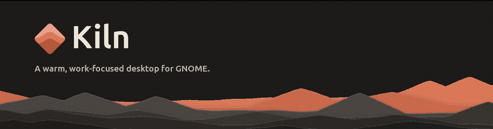
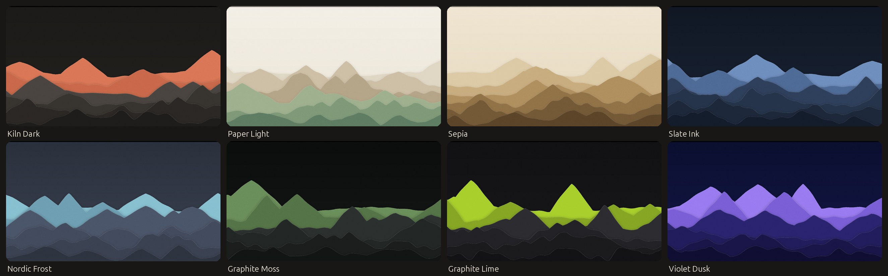
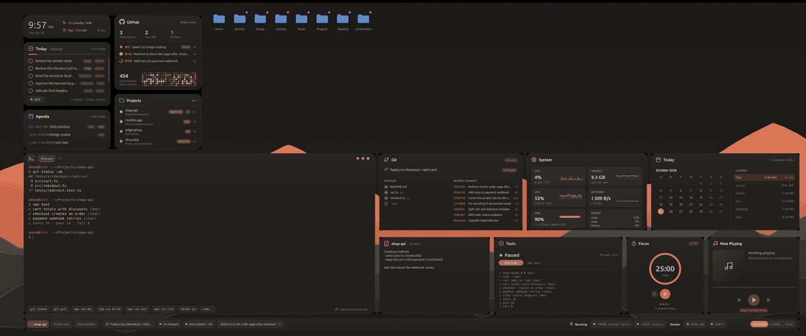
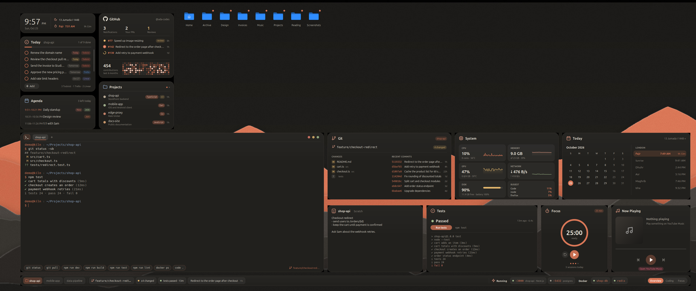
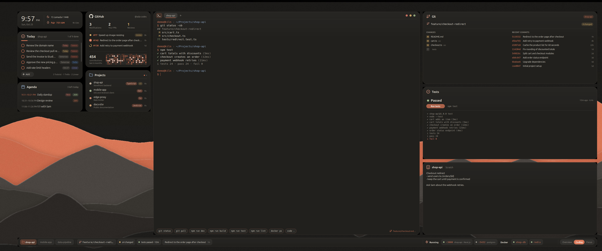
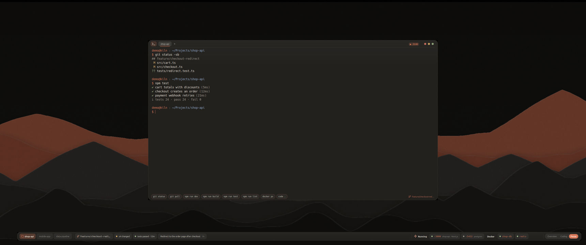
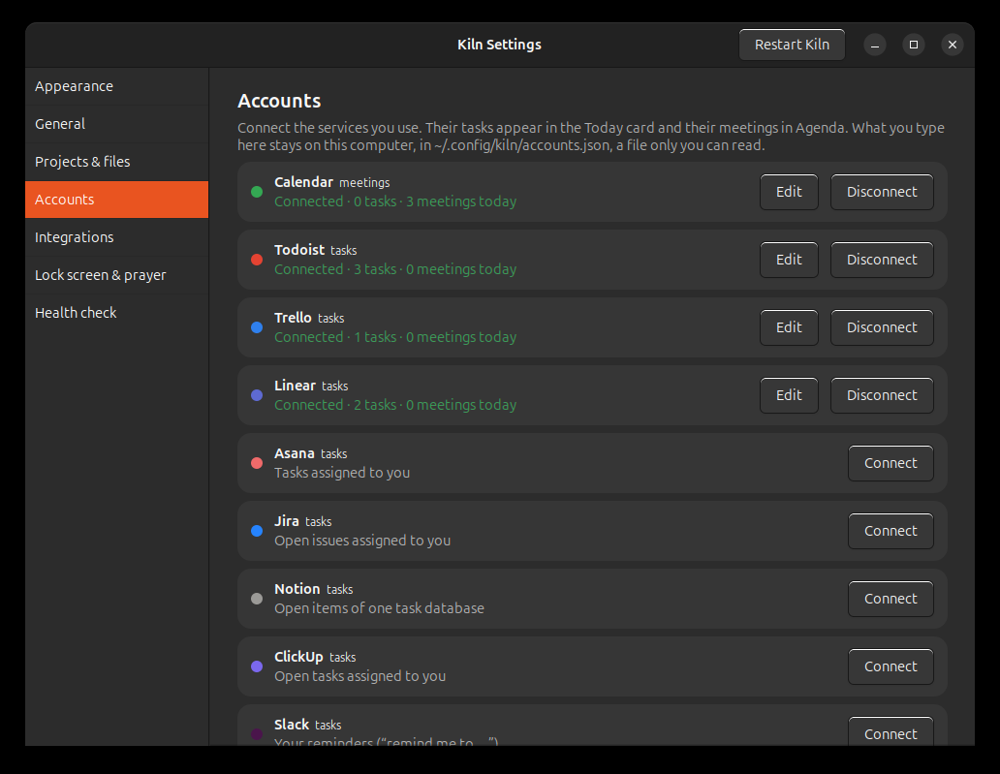

<div align="center">



**Live cards for your day, a real terminal on the wallpaper, a work bar that knows what you are building,
and a lock screen that is actually useful, all in eight paper-cut themes.**



</div>



<details>
<summary>Screenshots (3440 × 1440, made-up data)</summary>







</details>

## What you get

| | |
|---|---|
| **Today** | Your own todo list, plus a tab for the project you are working on. That tab also shows the tasks of your latest Claude Code session there. Tasks from Todoist, Trello, Linear, Asana, Jira, Notion, ClickUp, Slack and Lark show up too once you [connect them](docs/ACCOUNTS.md). |
| **GitHub** | Notifications, your open pull requests with CI status, review requests and a 6-month contribution heatmap (through the `gh` CLI). |
| **Projects** | Your most recently touched git repositories, with language and uncommitted-change badges. |
| **Agenda** | Today's meetings from Google, Outlook or Apple Calendar (any iCal link) or Lark, with a Join button for video calls. |
| **Terminal** | A real terminal on the desktop: tabs, split panes (Ctrl+Shift+E / O), the current git branch, and new tabs that open in the project you are working on. The **▾** next to **+** opens a tab anywhere else: home, desktop, another recent project or any folder, and the buttons under the terminal follow the folder of the tab you are in. The buttons under it come from the project's own files (`package.json` scripts, Makefile, `manage.py`, Cargo, Go, Flutter...). |
| **Focus** | A Pomodoro timer (25 / 5 min; scroll to change the length) that counts today's sessions. |
| **Now Playing** | Any MPRIS player (Spotify, YouTube Music in a browser…), with artwork, seek bar and controls. |
| **Work bar** | Detects the projects you have open (VS Code windows, Claude Code sessions, terminals) and lets you switch between them. It shows the branch, ahead/behind, changes, pull request and CI status, the last commit, and a **tests** button that runs the project's tests and keeps the result. It also lists your running dev servers, local services and Docker containers, which you can open, stop or hide. At its right end: **Overview / Coding / Focus** modes. |
| **Dock cards** | On a big screen (about 2500 px wide and up) Kiln fills the free space beside the terminal with cards: **Git** (changed files and recent commits of the current project, click to open), **System** (CPU, memory, GPU, network, disk and the busiest programs), **Today** (month calendar, Hijri date and prayer times), **Notes** (a scratchpad per project, plus a global one) and **Tests** (status, a run button and the tail of the last log; without a test command it lists the project's scripts). An optional **Running** card lists dev servers and Docker containers. The clock card shows the Hijri date and the next prayer. A laptop screen gets no dock cards. |
| **Modes** | **Overview**: every card. **Coding**: a wide terminal with Git, Tests and Notes stacked in a column on its right. **Focus**: one large, near-opaque terminal in bigger type on a dimmed screen, with a timer pill in its header, and notification banners are silenced until you leave. Switch from the work bar, with **Super+J**, or `kiln mode`. |
| **Desktop icons** | Folder icons in the theme's colours, with per-folder colour and symbol, drag and drop, multi-select, rename and trash. A dot marks what changed in the last two days, and *Group icons by type* (right-click the desktop) puts project folders, other folders and files in rows of their own. |
| **Launcher** (Super+K) | Search apps, projects, desktop items and recent files, do maths, run `>commands`, add todos and switch themes, or search the web. |
| **Top bar** | Workspace badge and desktop name, a search pill, the date on the right, and themed menus, quick settings, notifications, OSD and Alt+Tab. Click the clock card on the desktop for a prayer-times popup. |
| **Lock screen** | A crisp wallpaper with your tasks, next meeting, GitHub and battery shown as counts only, never titles. It also has Now Playing with controls, a live Focus countdown, prayer times (12 calculation methods, offline) and day/week progress. |
| **Themes** | Kiln Dark, Paper Light, Sepia, Slate Ink, Nordic Frost, Graphite Moss, Graphite Lime and Violet Dusk. Each one sets GTK (including the accent colour of GNOME Settings and other GTK apps), icons, the Kiln app icon, dock, GNOME Terminal, folders, top bar and widgets, with its own generated wallpaper. Kiln keeps the dock on the left. It also runs lighter on older computers (`performance` in the config). |

## Requirements

* **GNOME Shell 46**, for example **Ubuntu 24.04**, on Wayland or X11. Other versions are untested.
* Python 3 with GTK 3 and VTE. The installer checks for these:
  `python3-gi gir1.2-gtk-3.0 gir1.2-vte-2.91 python3-gi-cairo python3-pil xdotool playerctl rsync`
* Optional:
  * [GitHub CLI](https://cli.github.com/) for the GitHub card and the PR/CI status.
  * [`lark-cli`](https://github.com/larksuite/cli) for Lark tasks and calendar.
  * `python3-dateutil`, for recurring events in a connected calendar.
  * Claude Code, for the project task view.

## Install

```bash
git clone https://github.com/MUHAMMEDHAFEEZ/kiln.git
cd kiln
./install.sh            # add --install-deps to apt-install anything missing
```

Then **log out and back in once** so GNOME loads the new top bar and lock screen.
Run `kiln doctor` at any time to check that everything is in place.

**Updates**: Kiln looks for a new signed release on GitHub a couple of minutes after it starts and then every few
hours. By default it tells you (a notification, then **Settings → General → Kiln updates → Update now**, or
`kiln update`). Set it to *Install them for me* to have it update by itself, or turn it off. Your settings,
themes and lists are kept, the previous version stays in `~/.local/share/kiln.prev`, and if a new version does
not start it is put back automatically (`kiln update --rollback` does it by hand). Installing from a clone
works too: `git pull` and `./install.sh`. A release is installed only if it carries the maintainer's signature, so nobody else can push an update ([SECURITY.md](SECURITY.md)). Details: [docs/CONFIGURATION.md](docs/CONFIGURATION.md).

<details>
<summary>What the installer changes</summary>

* Copies the code to `~/.local/share/kiln`, the `kiln` command to `~/.local/bin` and the shell extension to `~/.local/share/gnome-shell/extensions/kiln-shell@local`.
* Creates `~/.config/kiln` with starter files. Existing files are kept.
* Adds an autostart entry and the **Super+K** shortcut. Your other custom shortcuts are kept.
* Turns off *Desktop Icons NG*, if it is on, because it covers the widgets and Kiln draws the icons itself. Skip this with `--keep-ding`.
* Applies the theme: GTK/icon theme, dark/light preference, wallpaper, dock colours and your default GNOME Terminal profile. Each of these can be switched off in the config.
* Saves your previous GNOME settings once to `~/.config/kiln/.restore`, so that `./uninstall.sh` can restore them.
* With `--claude-hook`, it adds a Claude Code *SessionStart* hook to `~/.claude/settings.json` (the file is backed up first). After that, Claude sees your project todos.

</details>

## Kiln Settings

Open **Kiln Settings** from the app menu (or run `kiln settings`). It opens by itself after the
first install.

* **Appearance**: a gallery of the themes with wallpaper previews. Apply one, use your own wallpaper
  for it, and choose what a theme may change outside Kiln.
* **General**: desktop name, 12/24-hour clock, web search engine.
* **Projects & files**: folders searched for projects, folders to skip, the folder shown as desktop icons.
* **Accounts**: connect Todoist, Trello, Linear, Asana, Jira, Notion, ClickUp, Slack, calendars and Lark.
* **Integrations**: GitHub, Claude Code (and its todo hook), YouTube-Music-only Now Playing.
* **Lock screen & prayer**: widgets on or off, wallpaper brightness and blur, prayer times by city,
  calculation method and language.
* **Health check**: the same check as `kiln doctor`, plus the log.

Changes are saved the moment you make them. Press **Restart Kiln** to load them into the widgets.

## Using Kiln

| | |
|---|---|
| **Super+K** | launcher |
| **Super+J** | switch mode: Overview, Coding, Focus |
| **Super+D** | show the desktop, Ubuntu's shortcut (the widgets stay visible) |
| Ctrl+Shift+E / O / W | in the terminal: split right / split down / close the pane |
| Click the GitHub logo | refresh GitHub, projects and your accounts now |
| Right-click anything | contextual actions (open in VS Code, copy path, stop server, hide…) |

The `kiln` command:

```text
kiln start | stop | restart | status | logs
kiln theme                 list themes          kiln theme sepia    switch theme
kiln mode coding           switch mode (overview | coding | focus | next)
kiln test                  run the tests of the project shown in the work bar
kiln todo add "Ship it"    personal list        kiln todo done 2
kiln tasks add "Fix login" list of the project in the current folder (-C <dir> for another)
kiln settings              open the Kiln Settings window
kiln config                open config.json     kiln doctor         check the installation
```

## Make it yours

* **Settings**: the Kiln Settings window, or by hand in `~/.config/kiln/config.json`. This sets the desktop name, the 12h/24h clock, which folders hold your projects, the web search engine, your city for prayer times, the lock-screen look, the integrations and which parts of the system a theme may change. See **[docs/CONFIGURATION.md](docs/CONFIGURATION.md)**.
* **Themes**: copy one into `~/.config/kiln/themes.json` and change its colours, or write a new one. See **[docs/THEMES.md](docs/THEMES.md)**.
* **Wallpaper**: drop `~/.config/kiln/wallpapers/<theme>.jpg` (or `.png`) and run `kiln theme <theme>`.
* **Folders**: right-click a folder, then *Color* or *Icon*.
* **Terminal buttons**: `~/.config/kiln/quick-commands.txt`, one command per line.
* **Project subtitles**: `~/.config/kiln/project-names.txt`.

## Known limitations

* The layout is computed from your **primary monitor**: on 1920×1080 it is compact, and on bigger
  screens (1440p, ultrawide) the terminal grows and the desktop-icon grid gets more columns and
  rows. If you plug a different screen in, Kiln re-arranges itself a couple of seconds later.
* Only the primary monitor gets widgets.
* The widgets are X11 windows (through Xwayland) because GNOME has no layer-shell. That is why
  they stay put on *Show Desktop* and never appear in Alt+Tab.

## Privacy

Everything runs locally. Kiln has no account and no telemetry. GitHub data comes from your own
`gh` login, and the tasks and meetings of the accounts you connect (saved only on this computer, see [ACCOUNTS.md](docs/ACCOUNTS.md)). The lock screen shows counts only
(for example "3 tasks left"), never task or meeting titles. Prayer times are calculated on your
machine.

## Troubleshooting

* **Widgets do not respond to clicks**: *Desktop Icons NG* is probably on. Run `gnome-extensions disable ding@rastersoft.com`.
* **Top bar or lock screen look like stock GNOME**: log out and back in once after installing. Then check `kiln doctor`.
* **Something looks wrong**: run `kiln logs`. If the widgets ever freeze for 4 s, the log shows where.
* **GitHub card says "connecting…"**: run `gh auth login`.

## Uninstall

```bash
./uninstall.sh          # keeps ~/.config/kiln;  --purge removes it too
```

This restores your previous theme, wallpaper, dock and terminal settings, re-enables
*Desktop Icons NG* if the installer turned it off, and removes the Claude Code hook.

## License

[MIT](LICENSE) © 2026 Mohammed Hafeez
