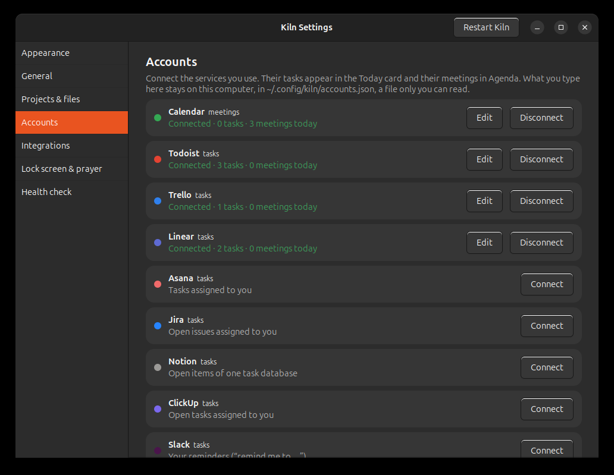
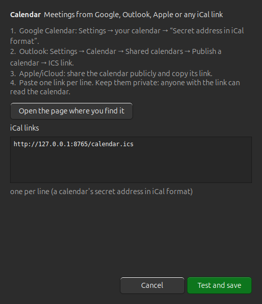

# Connecting your accounts

Kiln can show the tasks and meetings you already keep somewhere else: tasks go into the **Today**
card, meetings into **Agenda**. Open **Kiln Settings → Accounts**, press **Connect** next to a
service and follow the three lines of instructions. Kiln tests the details before it saves them.





From a terminal: `kiln accounts` lists them, `kiln connect todoist` asks for the details,
`kiln disconnect todoist` removes them, `kiln sync` refreshes now.

| Service | What you paste | What Kiln shows | Tick off from Kiln |
|---|---|---|---|
| **Calendar** (Google, Outlook, Apple, Proton, any iCal link) | The calendar's private iCal link, one per line | Today's meetings, with a **Join** button for Zoom, Meet, Teams and Webex links | |
| **Todoist** | API token (Settings → Integrations → Developer) | Overdue, today and the next 7 days | yes |
| **Trello** | API key and token ([power-ups admin](https://trello.com/power-ups/admin)) | Your cards that are due within a week | yes (marks the due date complete) |
| **Linear** | Personal API key (Settings → Account → Security) | Your open issues | yes (moves it to the team's "done" state) |
| **Asana** | Personal access token | Your incomplete tasks | yes |
| **Jira** | Site (`yourteam.atlassian.net`), email, API token | Open issues assigned to you | yes (uses a transition to *Done*) |
| **Notion** | Integration token and the link of one tasks database | Its open items | yes (checkbox, or a status in the *Complete* group) |
| **ClickUp** | Personal API token | Open tasks assigned to you | yes |
| **Slack** | User token (see below) | Your reminders (`/remind me to …`) | yes |
| **Lark** | Nothing: set up `lark-cli` once (see its page) | Tasks and meetings | yes |
| **Lark Base** | The link of a tasks table, and optional lists (see below) | The **Tasks board** (a card and a full Tasks mode) with a tab per list, and what you are working on in Today | yes, and you can add tasks and move them between statuses |

Each task carries a small label with its service. Click a task to open it in the service, right-click for
*Mark complete* and *Copy*. Tasks refresh every two minutes.

## Where your details go

* They are saved in `~/.config/kiln/accounts.json`. The folder and the file can only be read by you
  (mode `700` / `600`). Nothing is sent anywhere except to the service itself, over HTTPS.
* Use *Disconnect* (or delete the file) to forget them. The tokens stay valid at the service until you revoke
  them there, so revoke a token when you stop using it.
* A calendar's iCal link works like a password: anyone with the link can read the calendar.
* The lock screen never shows task titles from any service, only counts.

## Slack

Slack's old personal tokens are retired, so you make a small app for yourself once:

1. Go to <https://api.slack.com/apps?new_app=1> → **From a manifest**, pick your workspace and paste:

   ```yaml
   display_information:
     name: Kiln
   oauth_config:
     scopes:
       user:
         - reminders:read
         - reminders:write
   settings:
     org_deploy_enabled: false
     socket_mode_enabled: false
   ```
2. **Install to Workspace**, then copy the **User OAuth Token** (it starts with `xoxp-`).
3. Paste it in Kiln.

## Lark Base (the Tasks board)

For a team's tasks table in Lark Base. Log in to `lark-cli` once with read-only access:

```bash
lark-cli auth login --scope "base:app:read base:table:read base:field:read base:record:read base:view:read"
```

To add tasks and change their status from Kiln, allow writing once more (you approve it in the browser):

```bash
lark-cli auth login --scope "base:record:create base:record:update"
```

Then connect **Lark Base** in Settings → Accounts and paste the link of the table (the address bar while the table is open;
it contains `/base/…` and `?table=tbl…`). Kiln adds a **Tasks** card on big screens with one tab for each list, and puts
the tasks assigned to you that are *Ongoing* in the Today card.

Lists are one per line, `Name = Field: value`, and `me` means your own tasks:

```
SHOP = PROJECTS: SHOP
BLOG = PROJECTS: BLOG
Ada = Task leader: me
```

Leave it empty to get one list per project plus yours. Kiln expects columns called *Task*, *Status*, *Task leader*,
*PROJECTS*, *Priority*, *Estimate Deadline* (or *End Date*) and *Departments*. If yours are named differently, add
`title_field`, `status_field`, `owner_field`, `project_field`, `priority_field`, `due_field` or `dept_field` to the
`larkbase` entry of `~/.config/kiln/accounts.json`. Done statuses are *Completed*, *Done*, *Closed* and *Complete*.
Click a task to open it in Lark. **Click the coloured dot** of a task to move it forward (not started → ongoing → completed;
on a completed task it reopens it), or right-click for *Move to…*. Statuses are red (not started), yellow (ongoing) and green
(completed). **+ New task** (on the card and on the board) opens a window for the title, project, status, priority,
department, who it is for, a due date and a note; `kiln newtask` opens the same window, and
`kiln newtask --title "Fix login" --list SHOP --priority Important --yes` adds a task without one.

The **Tasks** mode (the last chip of the mode switcher, or `kiln mode tasks`) fills the screen with the board: three status
columns, a card per task, a progress bar and the tabs. Ticking a Lark Base task off in the **Today** card completes it in the Base.

## Notion

Create an internal integration at <https://www.notion.so/profile/integrations>, open your tasks database,
choose **••• → Connections** and add the integration, then copy the database link. Kiln looks for the
title, a date column (a column called *Due* or *Date* is preferred) and a checkbox or *Status* column.

## When something does not work

The Accounts page shows a plain message under the service (for example *The service rejected these details*
or *Cannot reach the service*). `kiln accounts` shows the same. Recurring calendar events need
`python3-dateutil` (`kiln doctor` checks it); without it only single events appear.

These connections were written from each service's public API documentation and are tested against a
local stand-in for every one of them (`python3 -m unittest discover -s tests`), not against every kind of real
account. If a service behaves differently for you, please open an issue with the message you see (never paste a
token).

## Adding a service

Each service is a small class in [`share/accounts.py`](../share/accounts.py): list what you need from the user
(`fields`) and the steps to get it (`steps`), then write `check` (does the login work?), `fetch` (return tasks
and events) and, if the service allows it, `complete`. Register it in `SERVICES`. It appears in Settings and in
`kiln connect` by itself. Add a test next to the others in `tests/test_accounts.py`.
